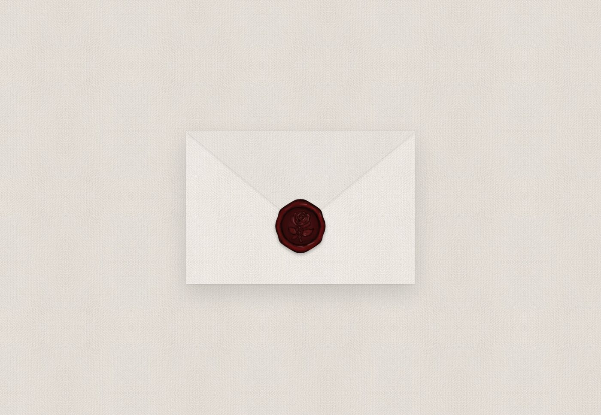
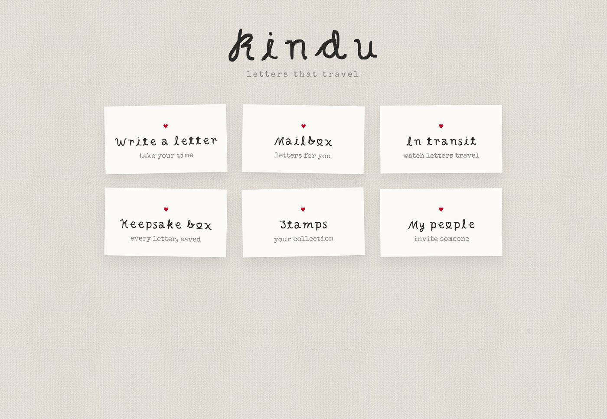
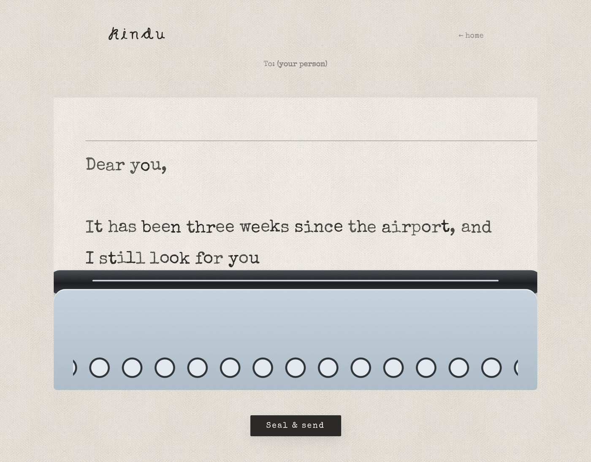
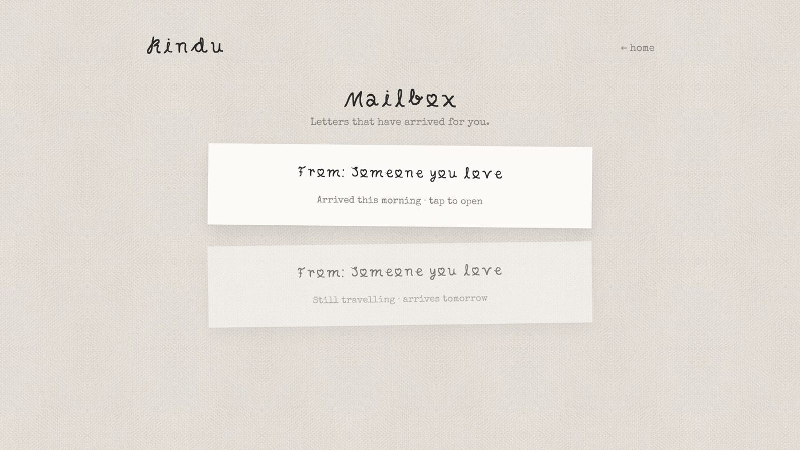
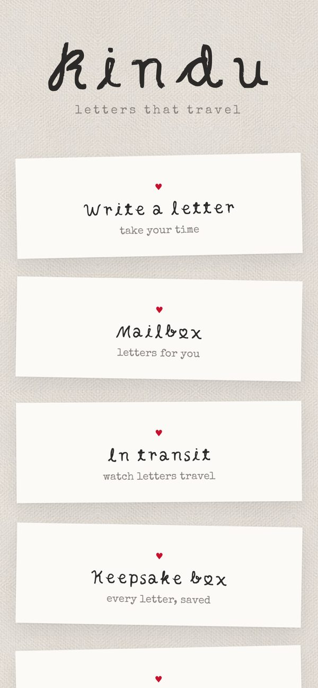

  

<h1 align="center">Rindu</h1>

<em>letters that travel</em>

---

**Rindu** is a letter app for people who are already close but live far apart: partners, best friends, family.

Letters on Rindu don't arrive instantly. Like real mail, they take time to travel across the world, and both people can watch them move on a map. When a letter finally arrives, it feels special again.

*Rindu* is a Malay word for the deep feeling of missing someone you love.

## My story

When I was 11, I had to move from Malaysia back to Korea suddenly. I never got to say goodbye to my closest friends.

Now I'm in a long-distance relationship myself, and several of my friends are about to go long distance too. Texting is instant, but it's also easy to forget. I wanted something that feels like the effort of a real letter: sitting down once a week, taking your time, and sending something the other person will keep.

I want to close the distance between people who love each other.

## What makes it different

Apps like Slowly are for meeting strangers. Rindu is for the people you already love.

- **Letters travel.** Delivery time depends on the real distance between you.
- **Watch it move.** Sender and receiver both see the letter travelling on a map.
- **Writing takes effort, on purpose.** Letters are typed on a zoomed-in typewriter, one key at a time.
- **Stamps and wax seals.** Choose a stamp for each letter.
- **A keepsake box.** Every letter you've sent and received, saved forever.

## What it looks like (early draft)

| Home | Writing a letter |
|---|---|
|  |  |

| Mailbox | On a phone |
|---|---|
|  |  |

This draft is a clickable prototype built with plain HTML, CSS and JavaScript. Nothing is saved yet; it shows the look and feel.

## The plan

**First version (MVP):**
1. Sign up and log in
2. Connect with your person through an invite link
3. Write a letter and send it
4. The letter travels for a time based on distance, then arrives
5. The receiver gets a notification and opens it in their mailbox
6. A simple, warm design that feels like real paper

**Timeline:**

| When | Goal |
|---|---|
| Nov – Dec 2026 | Learn the basics, talk to future users, design the app |
| January 2027 | Build the first working version |
| February 2027 | Launch to 10–50 real users in long-distance couples and friendships |
| March 2027 | Improve from feedback and share progress online |
| April 2027 | Apply for grants and decide what comes next |

**Later ideas** (not for now): a stamp shop, "open when..." letters, countdown letters before you meet again, and sending a small gift from a local shop with your letter.

## Built with

Right now: HTML, CSS and JavaScript. Next: Next.js, Supabase and Vercel.

I'm building Rindu while learning web development, so this repository is also a record of me learning.

## Credits

- **Rindu font, wax seal and paper texture:** made by me. All rights reserved.
- **Special Elite font:** by Astigmatic, under the Apache 2.0 licence (see `FONT-LICENSE-SpecialElite.txt`).

---

Made by Sion ♥

